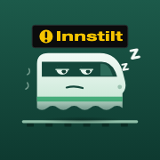

<p align="center"></p>

# Innstilt

**Erstatning når toget er forsinket eller innstilt – uten bryet med Vy sitt skjema.**
Innstilt finds your cancelled and late trains in Entur's open data and opens Vy's own claim form already filled in.
You check it and press *Send inn* yourself.

**Use it: [innstilt.app](https://innstilt.app)** – works in any browser; on a phone, add it to your home screen.
An Android app is in testing.

> *Innstilt is not affiliated with Vy.* No login, no account, no ads, no tracking. Your ticket, name, e-mail and
> bank account stay on your own device and go only to Vy, when you send a claim. Optional anonymous statistics
> share only numbers of claims and kroner. Details: [privacy policy](https://innstilt.app/personvern.html) ·
> [security review](docs/security.md).

## Status

### ✅ Working

**Web app** ([`web/`](web/), live at [innstilt.app](https://innstilt.app)) – Norwegian and English
- **Trips you can claim:** cancelled and over-30-minute-late trains on your regular trips, 90 days back, matched to
  the ticket valid that day; today's trains live from Entur.
- **"Nå" board:** your departures right now – platform, delays, cancellations; cancelled trains claimable at once.
- **"Another trip":** any stations, date and time.
- **Claims:** status (pending / paid / rejected), amounts, case numbers, deadline warnings.
- **Tickets:** Vy reference codes and tickets from the Ruter app / Entur (Vy's "manual" path), several tickets,
  validity from one date plus a period.
- **Gaps in the archive:** trains that were planned but left no trace (e.g. a standstill) are claimable.
- **Introduction and "?" help**, privacy policy, export/import between devices, works offline.
- **Most cancelled lines of the month** (public data) and an opt-in **refund counter**.

**Bookmarklet** ([`bookmarklet/`](bookmarklet/)) – "👻 Innstilt: fyll ut" sets the departure time and train in Vy's
form on a computer, and hands the case number back to Innstilt after sending.

**Android app** ([`app/`](app/), Capacitor) – runs on a Pixel 8
- Vy's form opens inside the app and is **filled in automatically** (time, train, optionally the ticket picture);
  the **case number is caught** and saved with the claim.
- **Notifications** (opt-in) when one of your usual trains is cancelled or more than 30 min late – a small native
  background check around your usual departure times.
- Data **encrypted** with a key in the Android Keystore. Permissions: internet, and notifications if you turn them on.

**Command-line tool** ([`cli/`](cli/)) – the original macOS/Linux version: scan, claim, status.

### 🚧 In progress

- **Google Play:** closed test with testers (listing, graphics and form answers ready in [`docs/play/`](docs/play/)).
- **First real users:** collecting where people get stuck.
- A real claim sent end to end from the Android app (form filling and case-number capture are tested against Vy's
  form, without sending).

### 💡 Planned / ideas

- Learn the payout amounts from paid claims.
- iPhone app.
- Other companies than Vy (Ruter, SJ, Go-Ahead, Flytoget …) – each has its own refund form.
- "Forsinket?" – a small game for the platform.

## How it works

1. **Find delays.** Entur's Journey Planner gives today's live times; Entur's SIRI-ET archive gives actual arrivals
   and cancellations for past days. A nightly job ([`tools/archive/`](tools/archive/)) turns the archive into small
   files for the app and keeps each day's planned timetable to spot trains that never ran.
2. **Pick your trips.** Only trains around your usual times on your regular trips, each with the ticket valid then.
3. **Claim.** Vy's form keeps its whole state in its web address, so Innstilt opens it prefilled. The time and train
   still need a real change in the form; the bookmarklet (computer) or the app does that. You review and send.

Vy's rules (checked 2026-11-20): compensation when you arrive more than 30 min late (60 min on Oslo–Bergen and
Flåm–Myrdal) or the train is cancelled; claims within 3 months. See Vy's own terms for the amounts.

## Repository

```
web/            the web app (vanilla ES modules, no build step) – published to innstilt.app
app/            Android app (Capacitor) wrapping web/; npm run phone / npm run bundle
bookmarklet/    innstilt.js -> build.py -> install page + the app's bookmark
stats/          Cloudflare Worker for the opt-in refund counter
tools/archive/  nightly data build (Entur archive -> web/data), planned timetables
tools/          serve.py (local server), screenshots.py (tutorial + Play screenshots)
cli/            the command-line tool
assets/icons/   ghost-train icons and renderers (web, Android, Play)
docs/           findings.md (how Vy's form and Entur's data behave), security.md, play/ (store listing)
```

Local development: `.venv/bin/python tools/serve.py` → http://localhost:8000. Technical background:
[`docs/findings.md`](docs/findings.md).

Data: [Entur](https://developer.entur.no/) open data under the [NLOD](https://data.norge.no/nlod) licence.
Code: [BSD 3-Clause](LICENSE). Made by a fed-up commuter on the Gjøvik line. Contact: perrong@innstilt.app
